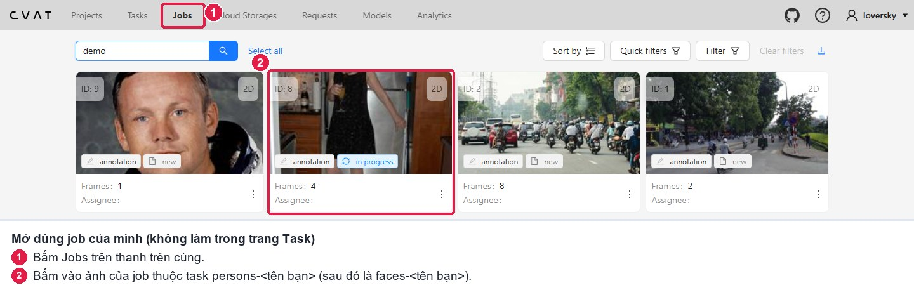
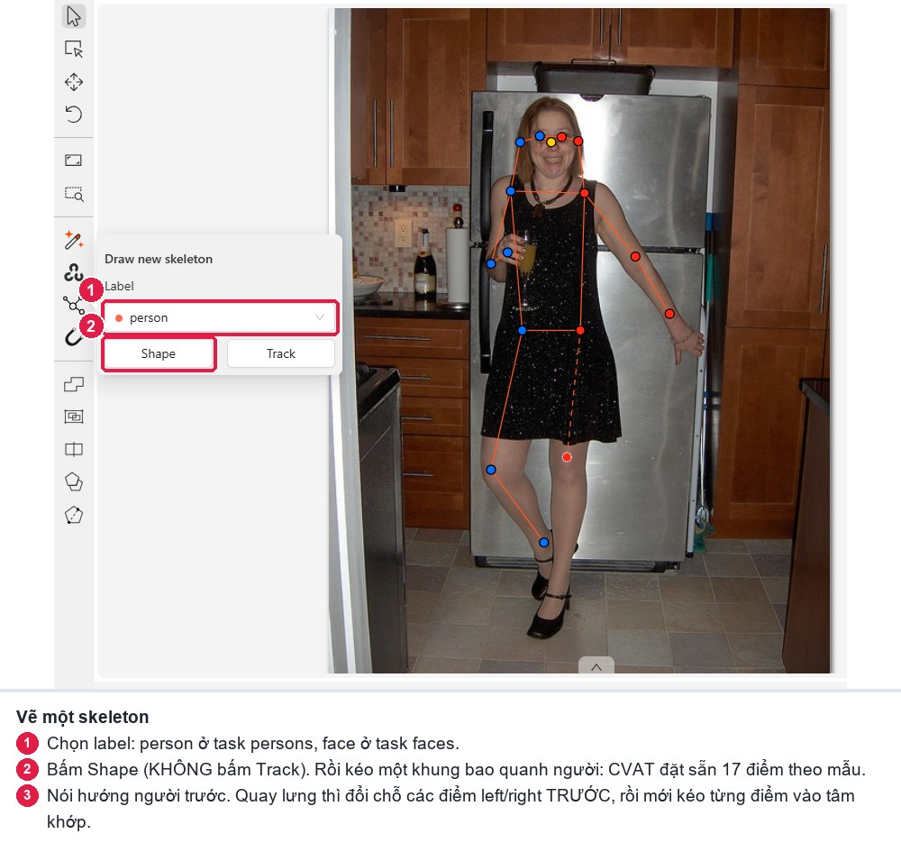
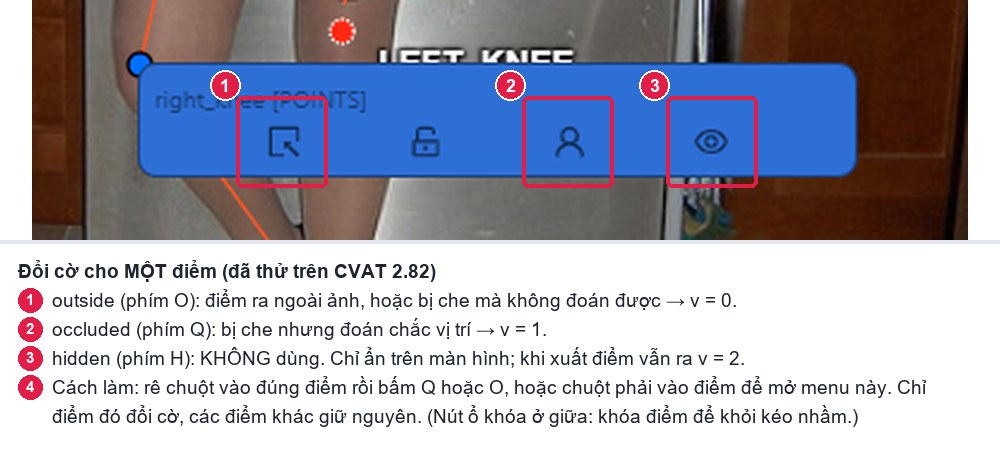
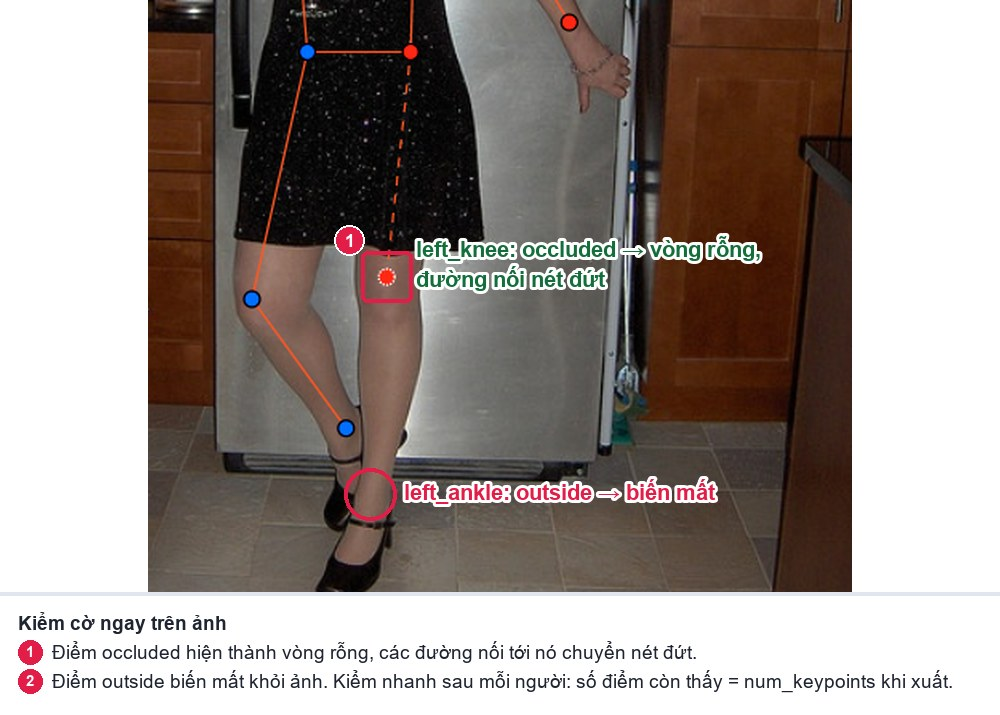
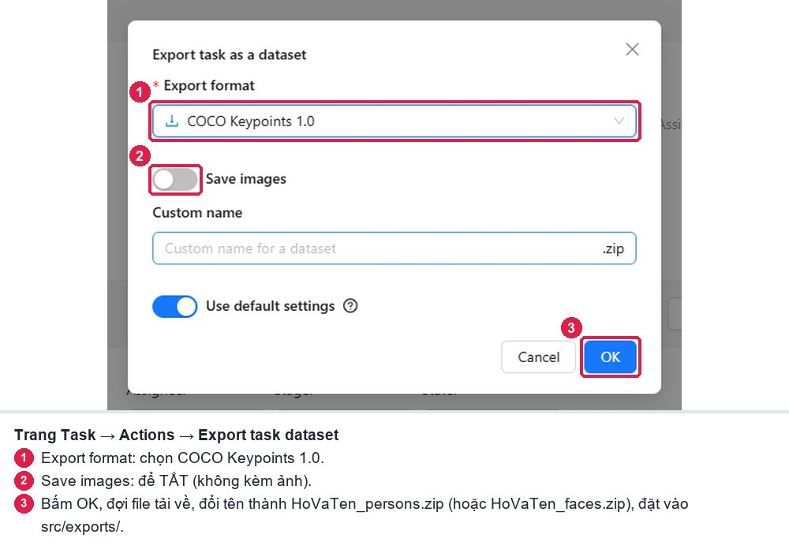

# CVAT — bảng tra nhanh cho Lab Ngày 4

Mọi thao tác dưới đây đã được thử trên **CVAT 2.82** (bản lớp dùng). Bản hướng dẫn có ảnh chụp từng bước: [`HUONG_DAN_BANG_HINH.md`](HUONG_DAN_BANG_HINH.md). Bảng phím đầy đủ trong CVAT: bấm `F1`.

## Mở job

1. Bấm vào đường link `python lab.py setup` in ra, hoặc vào **Jobs** (không làm trong trang Task) và mở job của task `persons-<tên>` / `faces-<tên>`.
2. Kiểm label trước khi gán: **Projects → d04-keypoint → Labels**. Label `person` và `face` phải là kiểu **Skeleton**. Bảng tên ở `docs/GUIDELINE.md`.

## Vẽ một skeleton

1. Thanh công cụ bên trái → biểu tượng **Draw new skeleton**.
2. Chọn label `person` (hoặc `face`), bấm **Shape** (không bấm Track: ảnh rời không cần track).
3. Kéo một khung bao người (hoặc bao mặt). CVAT đặt các điểm theo mẫu vào khung.
4. Nói hướng người. Nếu quay lưng: kéo các điểm `left_*` sang bên trái ảnh trước.
5. Kéo từng điểm vào tâm khớp. Lăn chuột để phóng to khi đặt mắt, mũi, tai, mí mắt.
6. Đặt cờ cho từng điểm cần đổi (mục dưới), nhìn lại đường nối, `Ctrl+S`.

## Đổi cờ cho MỘT điểm của skeleton

**Rê chuột vào đúng điểm** (điểm sáng lên), rồi:

- bấm `Q` → điểm đó thành `occluded` (`v = 1`), hoặc
- bấm `O` → điểm đó thành `outside` (`v = 0`), hoặc
- **chuột phải** vào điểm để mở menu có 4 nút: outside · khóa · occluded · hidden.

Chỉ điểm đang rê chuột bị đổi; các điểm khác và cả skeleton giữ nguyên (đã kiểm bằng dữ liệu lưu trên server). Bấm lại phím lần nữa để tắt cờ.

Tự kiểm sau mỗi người:

- Điểm `outside`: biến mất khỏi ảnh.
- Điểm `occluded`: thành vòng rỗng, các đường nối tới nó thành nét đứt.
- **Không dùng `hidden` (`H`)**: nó chỉ ẩn trên màn hình của bạn, không được lưu; khi xuất, điểm vẫn ra `v = 2` ở chỗ cũ.

## Phím tắt hay dùng

| Phím | Tác dụng |
|---|---|
| `N` | Bắt đầu / kết thúc vẽ với công cụ đang chọn |
| `F` / `D` | Ảnh sau / ảnh trước |
| `Q` (rê chuột vào điểm) | Bật / tắt `occluded` cho điểm đó |
| `O` (rê chuột vào điểm) | Bật / tắt `outside` cho điểm đó |
| `L` | Khóa / mở khóa (tránh kéo nhầm skeleton đã xong) |
| `Ctrl+S` | Lưu |
| `Esc` | Hủy thao tác vẽ đang dở |
| `F1` | Bảng phím đầy đủ |

## Sửa lỗi

| Tình huống | Cách sửa |
|---|---|
| Đổi trái/phải cả người (quay lưng) | Xóa skeleton, vẽ lại, đổi chỗ các điểm `left_*` / `right_*` trước rồi mới tinh chỉnh. Hoặc kéo từng cặp điểm về đúng bên |
| Bật nhầm cờ cho điểm khác | Rê chuột vào điểm đó, bấm lại `Q` / `O` để tắt |
| Điểm ngoài ảnh đã bị kéo về mép | Bật `outside` cho điểm đó |
| Lỡ vẽ skeleton trên poster, tượng | Chọn skeleton, `Delete` |
| Hai skeleton cho cùng một người | Xóa skeleton kém hơn |
| Giao diện đứng ở "Connecting…" quá 1 phút | Chạy `python lab.py check` (tự sửa), rồi tải lại trang |

## Xuất file

**Cách nhanh:** `python lab.py export` làm hết các bước dưới và tự kiểm. Cách tay:

1. Mở trang **Task** `persons-<tên>` → **Actions → Export task dataset** (hoặc trong job: **Menu → Export job dataset**).
2. Định dạng **COCO Keypoints 1.0** (không phải COCO 1.0, không phải CVAT for images).
3. **Tắt Save images.**
4. Tải về, đổi tên thành `HoVaTen_persons.zip`, đặt vào `src/exports/`.
5. Làm tương tự với task `faces-<tên>` → `HoVaTen_faces.zip`.
6. Trong job: **Menu → Finish the job** (job chuyển sang completed).

Bên trong zip có `annotations/person_keypoints_default.json` (cả với task faces). Không mở và sửa file này bằng tay.

Hai điều đã kiểm trên CVAT 2.82:

- Điểm `outside` xuất ra `v = 0` nhưng vẫn ghi tọa độ cũ (không phải `0, 0`). Bình thường, không phải lỗi.
- CVAT **không** tự cắt điểm bị kéo ra ngoài khung: điểm `v = 2` nằm ngoài ảnh vẫn được xuất nguyên, và script tự kiểm sẽ báo `[LỖI]`. Điểm ngoài ảnh phải bật `outside`.

## Server chậm

Đóng tab khác, dùng Chrome hoặc Edge, khóa (`L`) các skeleton đã xong để không kéo nhầm.
