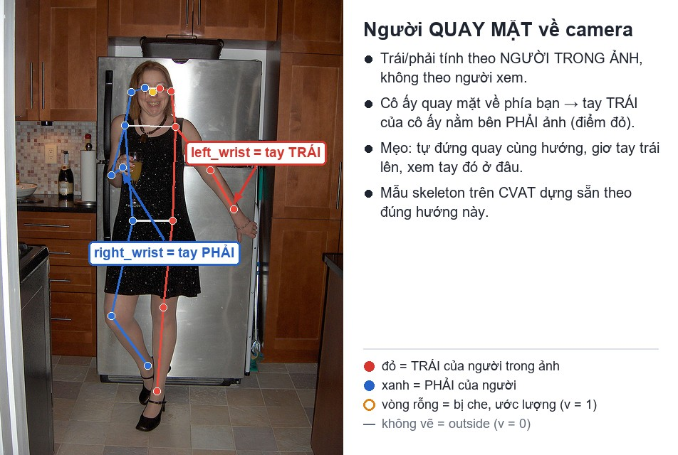
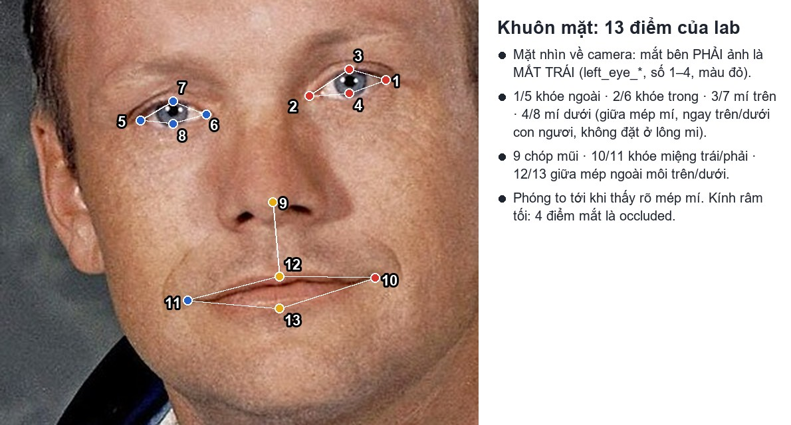
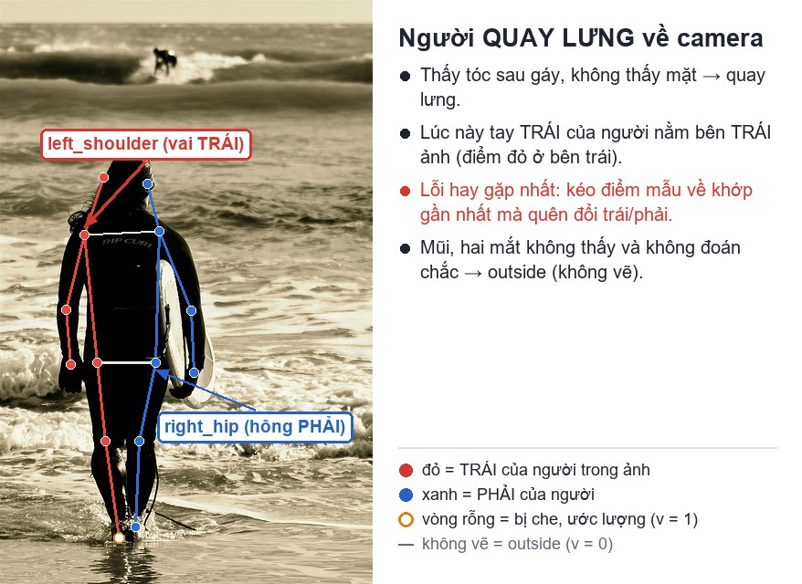
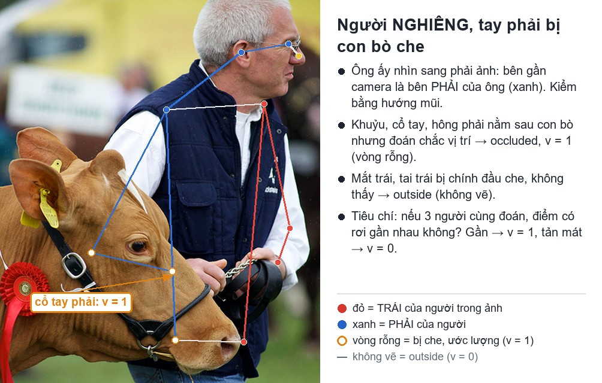
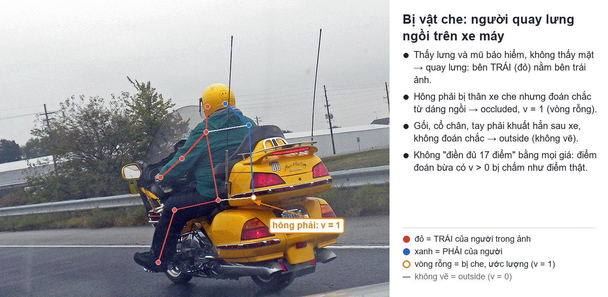
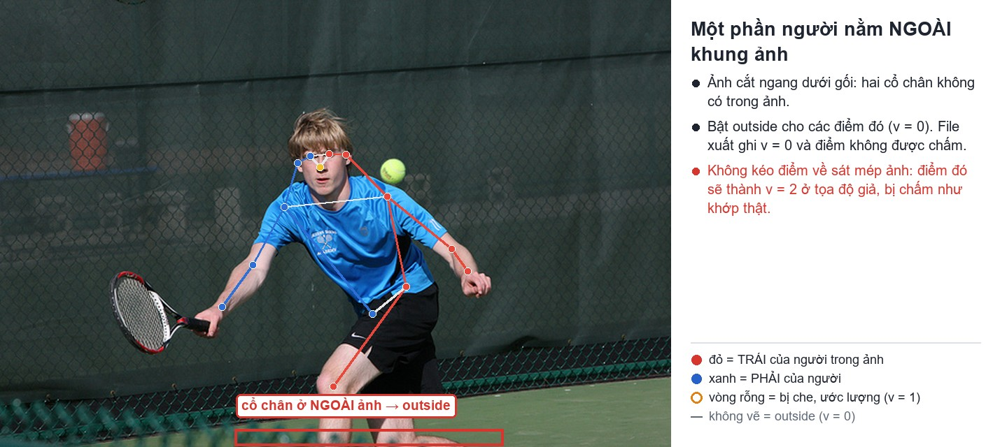
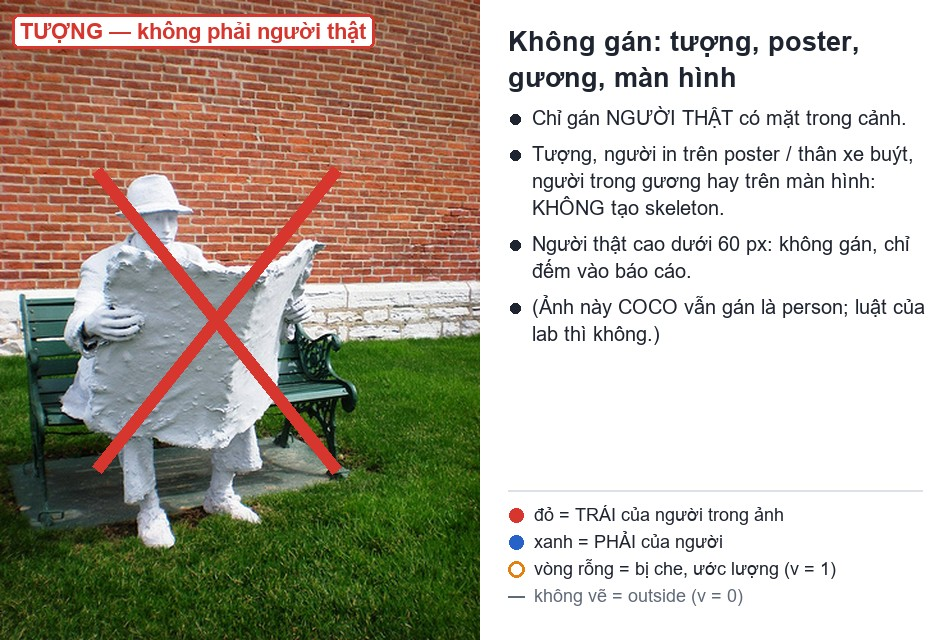

# Quy ước nhãn — Lab Ngày 4 (Keypoint & Pose)

> Mới dùng CVAT? Xem trước bản có ảnh từng bước: [`HUONG_DAN_BANG_HINH.md`](HUONG_DAN_BANG_HINH.md). Màu trong mọi ảnh: **đỏ = trái của người**, **xanh = phải**, vòng rỗng = `v = 1`, không vẽ = `v = 0`.

Đây là nguồn quy tắc duy nhất cho buổi lab. Bộ điểm và cờ `v` theo chuẩn COCO. Ngưỡng 60 px và bộ 13 điểm khuôn mặt là quy ước riêng của lab. Ở dự án thật, guideline của dự án là nguồn quy tắc duy nhất khi hai bên khác nhau.

## 1. Skeleton người: 17 điểm COCO, 19 cạnh

Tên trên CVAT phải đúng từng chữ, thứ tự 1 → 17. Script tự kiểm và script chấm đọc điểm theo tên.

| # | Tên trên CVAT | Nghĩa | # | Tên trên CVAT | Nghĩa |
|---:|---|---|---:|---|---|
| 1 | `nose` | mũi | 10 | `left_wrist` | cổ tay trái |
| 2 | `left_eye` | mắt trái | 11 | `right_wrist` | cổ tay phải |
| 3 | `right_eye` | mắt phải | 12 | `left_hip` | hông trái |
| 4 | `left_ear` | tai trái | 13 | `right_hip` | hông phải |
| 5 | `right_ear` | tai phải | 14 | `left_knee` | gối trái |
| 6 | `left_shoulder` | vai trái | 15 | `right_knee` | gối phải |
| 7 | `right_shoulder` | vai phải | 16 | `left_ankle` | cổ chân trái |
| 8 | `left_elbow` | khuỷu tay trái | 17 | `right_ankle` | cổ chân phải |
| 9 | `right_elbow` | khuỷu tay phải | | | |

19 cạnh (đánh số từ 1, giống file COCO):

```text
[16,14] [14,12] [17,15] [15,13] [12,13] [6,12] [7,13] [6,7] [6,8] [7,9]
[8,10] [9,11] [2,3] [1,2] [1,3] [2,4] [3,5] [4,6] [5,7]
```

Gồm: cổ chân – gối – hông hai bên; hông – hông; vai – hông hai bên; vai – vai; vai – khuỷu – cổ tay hai bên; mắt – mắt; mũi – mắt hai bên; mắt – tai hai bên; tai – vai hai bên.

Đường nối chỉ giúp nhìn ra lỗi, không đổi tọa độ. Hai đường chân bắt chéo nhau thường là dấu hiệu đổi trái/phải.

Mẫu `person` trên CVAT dựng theo người **quay mặt về camera**: các điểm `left_*` nằm bên **phải** khung mẫu.



## 2. Skeleton khuôn mặt: 13 điểm của lab

| # | Tên | Đặt ở đâu |
|---:|---|---|
| 1 | `left_eye_outer` | khóe ngoài mắt trái (của người) |
| 2 | `left_eye_inner` | khóe trong mắt trái |
| 3 | `left_eye_upper` | điểm giữa mép mí trên mắt trái, ngay trên tâm con ngươi |
| 4 | `left_eye_lower` | điểm giữa mép mí dưới mắt trái, ngay dưới tâm con ngươi |
| 5 | `right_eye_outer` | khóe ngoài mắt phải |
| 6 | `right_eye_inner` | khóe trong mắt phải |
| 7 | `right_eye_upper` | điểm giữa mép mí trên mắt phải |
| 8 | `right_eye_lower` | điểm giữa mép mí dưới mắt phải |
| 9 | `nose_tip` | chóp mũi |
| 10 | `mouth_left` | khóe miệng trái (của người) |
| 11 | `mouth_right` | khóe miệng phải |
| 12 | `lip_upper` | giữa mép ngoài môi trên |
| 13 | `lip_lower` | giữa mép ngoài môi dưới |

Nối: hai khóe của mỗi mắt với mí trên và mí dưới của mắt đó; hai khóe miệng với môi trên và môi dưới; chóp mũi với `lip_upper` (13 cạnh).

Cặp trái/phải dùng khi lật ảnh: `left_eye_*` ↔ `right_eye_*` (4 cặp) và `mouth_left` ↔ `mouth_right`.

Bộ 13 điểm là bộ của lab, nằm giữa bộ 5 điểm (MTCNN) và bộ 68 điểm (dlib / iBUG 300-W). Lab chọn đủ điểm mí mắt để tính được tỉ số mở mắt, là loại điểm hệ thống giám sát tài xế (DMS) cần.



## 3. Ba luật cho cả buổi

1. **Trái/phải theo người trong ảnh.** Trước khi kéo điểm, nói ra hướng người. Rồi mới đặt left/right.
2. **Không đoán bừa.** Thấy: `v = 2`. Bị che nhưng ước lượng chắc: `occluded` (`v = 1`). Ngoài ảnh hoặc không đoán được: `outside` (`v = 0`).
3. **Chỉ gán người thật trong cảnh.** Poster, ảnh in, gương, màn hình: không gán. Người cao dưới 60 px: không gán, đếm vào báo cáo.

### Trái/phải theo hướng người

| Hướng người | Tay trái của họ nằm ở | Cách kiểm |
|---|---|---|
| Quay mặt về camera | bên **phải** ảnh | Thấy mũi, mắt; mũi bàn chân hướng về camera |
| Quay lưng về camera | bên **trái** ảnh | Thấy tóc sau gáy, không thấy mặt |
| Nghiêng, nhìn sang phải ảnh | bên xa camera (bên gần camera là bên **phải** của họ) | Hướng mũi, mũi bàn chân |
| Nghiêng, nhìn sang trái ảnh | bên gần camera | Hướng mũi, mũi bàn chân |

Mẹo: tự đứng vào vị trí người đó, quay cùng hướng, rồi hỏi "tay này là tay nào của tôi?". Không đoán được hướng (ảnh mờ, người ngồi cuộn tròn): ghi vào bảng ca khó và hỏi coach, không chọn bừa.



## 4. Cờ visibility: bốn câu hỏi cho mỗi điểm

```text
Câu 1: Là người thật trong cảnh?        Không → không tạo skeleton
Câu 2: Điểm nằm trong ảnh?              Không → outside (v = 0)
Câu 3: Nhìn thấy khớp?                  Có    → bình thường (v = 2)
Câu 4: Ước lượng được chắc chắn?        Có    → occluded (v = 1)
                                        Không → outside (v = 0)
```

"Ước lượng chắc chắn" nghĩa là: nếu ba người cùng ước lượng, ba điểm sẽ rơi gần nhau. Gần thì `v = 1`, tản mát thì `v = 0`.









| Tình huống | Trên CVAT | `v` khi xuất | Ghi nhớ |
|---|---|---:|---|
| Thấy rõ khớp, kể cả dưới áo mỏng hoặc tóc lòa xòa | bình thường | 2 | đặt vào tâm khớp, không đặt lên viền quần áo |
| Bị vật hoặc người khác che, ước lượng chắc | `occluded` | 1 | dựa vào khớp lân cận và đối xứng |
| Tự che (người nghiêng, tay bắt chéo, ngồi co chân) | `occluded` | 1 | vẫn đúng tên trái/phải của người |
| Khớp bị vật mảnh chắn ngang (cột đèn), hai đoạn chi còn thấy | `occluded` | 1 | vị trí rõ từ hai đoạn chi |
| Bị che, không ước lượng được | `outside` | 0 | ghi lý do vào bảng ca khó |
| Nằm ngoài khung ảnh | `outside` | 0 | **không** kéo điểm về mép ảnh |
| Kính râm tối che mắt (ảnh màu) | `occluded` | 1 | đặt sau tròng kính theo gọng |
| Người quay lưng: mũi, mắt không thấy và không đoán chắc | `outside` | 0 | tai thấy viền thì `v = 2` |
| Poster, gương, màn hình | không tạo skeleton | — | không phải người trong cảnh |

**Không dùng cờ `hidden`** (phím `H`) để thay cho `occluded`. `hidden` chỉ ẩn điểm trên màn hình, không được lưu lên server (đã kiểm trên CVAT 2.82); khi xuất, điểm vẫn ra `v = 2` ở tọa độ cũ.

### Vì sao cờ quan trọng với model

- Điểm `v = 0` có trọng số 0 trong loss: model đoán gì ở đó cũng không bị phạt.
- Điểm `v = 1` và `v = 2` có trọng số 1: model học theo vị trí bạn đặt, kể cả vị trí đoán bừa.
- Khi chấm OKS, chỉ điểm `v > 0` được tính. Một điểm đoán bừa có `v = 1` bị chấm như điểm thật.

Vì vậy: **không "điền đủ 17 điểm" bằng mọi giá.** Một điểm `v = 0` đúng chỗ không bị trừ; một điểm đoán bừa thì có.

## 5. Ca khó theo nhóm ảnh

| Nhóm | Lưu ý |
|---|---|
| `easy` | Phóng to khi đặt mắt, mũi, tai: σ của các điểm này nhỏ nhất nên OKS phạt nặng nhất. Hông đặt vào khớp, không vào cạp quần |
| `occluded` | Chân sau capô xe, tay sau lưng: dựa vào đùi, cánh tay trên để quyết định `v = 1` hay `v = 0` |
| `back` | Đổi chỗ left/right trước khi tinh chỉnh. Mặt không thấy: `v = 0` hoặc `v = 1` theo bốn câu hỏi, không mặc định `v = 2` |
| `small` | Người cao dưới 60 px: không gán, đếm vào báo cáo. Người từ 60 px: phóng to tối đa |
| `crowd` | Lần theo chi từ vai hoặc hông: vai → khuỷu → cổ tay. Mỗi người một skeleton riêng, không gộp, không để xương vắt sang người khác. Người phía sau chỉ lộ đầu và một vai vẫn gán nếu cao từ 60 px (phần không thấy là `outside`) |
| Mặt nghiêng | Mắt xa bị sống mũi che một phần: `occluded` nếu đoán chắc |
| Kính | Kính râm tối: bốn điểm mắt `occluded`. Kính trong: mắt thấy được, `v = 2` |

Ngưỡng 60 px là quy ước của lab hôm nay, không phải quy định của COCO.

## 6. Mã lỗi dùng khi tự review

| Mã | Ý nghĩa |
|---|---|
| `lr_swap` | đổi trái/phải, một cặp điểm hoặc cả người |
| `vis_flag` | cờ sai: `v = 2` thay vì 1, `v = 1` thay vì 0, điểm ngoài ảnh không phải `outside`… |
| `position` | điểm lệch khỏi tâm khớp thấy rõ |
| `missing` | thiếu người cần gán (cao từ 60 px) |
| `extra` | gán người không cần gán (poster, gương, dưới 60 px, trùng người) |
| `ok` | đã kiểm, không có lỗi |

Điểm phân vân giữa `v = 1` và `v = 0`: ghi cả hai lựa chọn và lý do chọn, không xóa.

## 7. Checklist self-QC trước khi Save và trước khi tự review

- [ ] Mỗi người cao từ 60 px có một skeleton; không có skeleton nào trên poster, gương, màn hình.
- [ ] Đã nói hướng người trước khi đặt điểm; left/right đúng theo người trong ảnh.
- [ ] Không có điểm nào nằm sát mép ảnh "cho có": điểm ngoài ảnh là `outside`.
- [ ] Đường nối không bắt chéo bất thường (hai chân, hai tay).
- [ ] Mắt, mũi, tai, mí mắt đặt khi đã phóng to; hông và gối ở tâm khớp.
- [ ] Các ca phân vân đã vào bảng ca khó của báo cáo. Đã `Ctrl+S`.
