# Hướng dẫn bằng hình — gán keypoint trên CVAT

Trang này dành cho người **mới dùng CVAT** hoặc chưa quen kỹ thuật. Đọc từ trên xuống, mỗi bước có ảnh chụp màn hình thật của CVAT. Quy tắc đầy đủ nằm ở [`GUIDELINE.md`](GUIDELINE.md).

Bạn chỉ cần nhớ 3 điều:

1. **Trái/phải tính theo người trong ảnh**, không theo bạn.
2. **Không đoán bừa:** thấy thì để bình thường, bị che mà đoán chắc thì bật `occluded`, ngoài ảnh hoặc không đoán được thì bật `outside`.
3. **Chỉ gán người thật**, cao từ 60 px trở lên.

---

## Phần A — Nhìn ảnh, quyết định trước khi bấm

Màu dùng trong mọi ảnh dưới đây: **đỏ = TRÁI của người**, **xanh = PHẢI của người**, vòng rỗng = bị che nhưng đoán được (`v = 1`), không vẽ = `outside` (`v = 0`).

### A1. Người quay mặt về camera

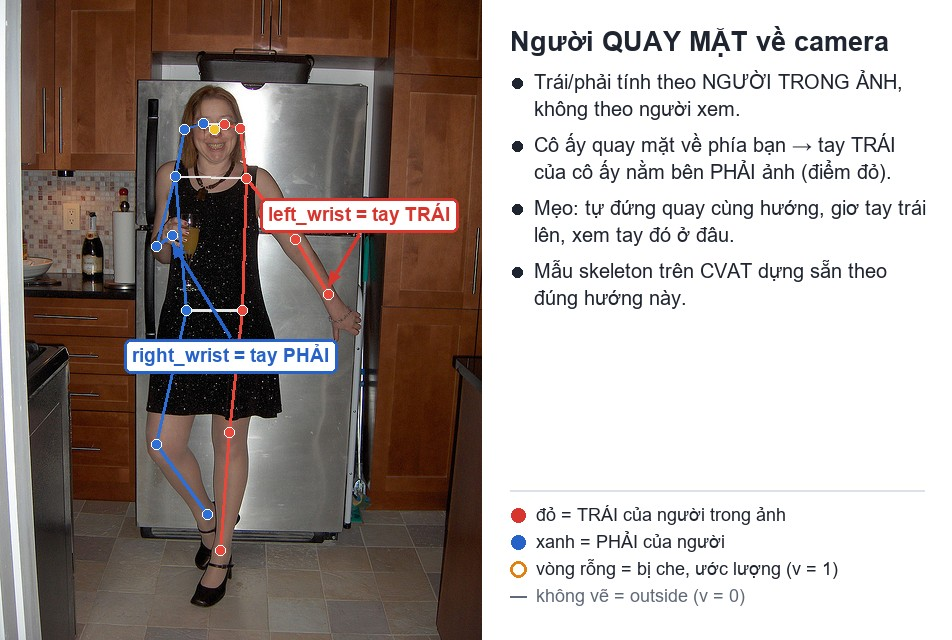

### A2. Người quay lưng về camera

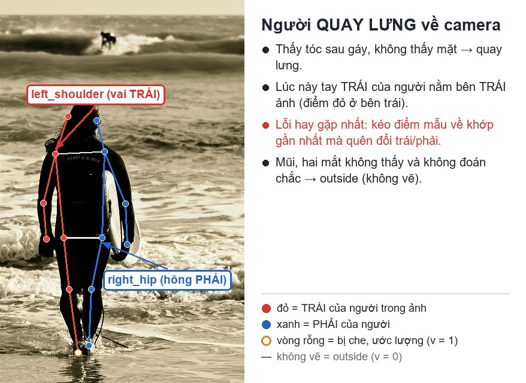

### A3. Người nghiêng, một phần bị che

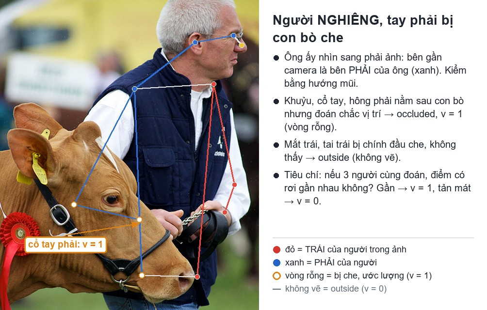

### A4. Bị vật che

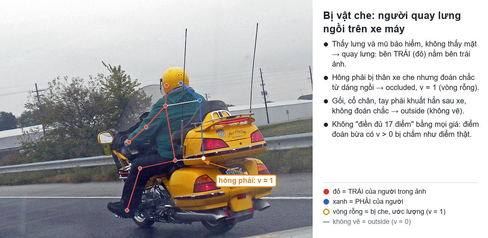

### A5. Một phần người ra ngoài khung ảnh

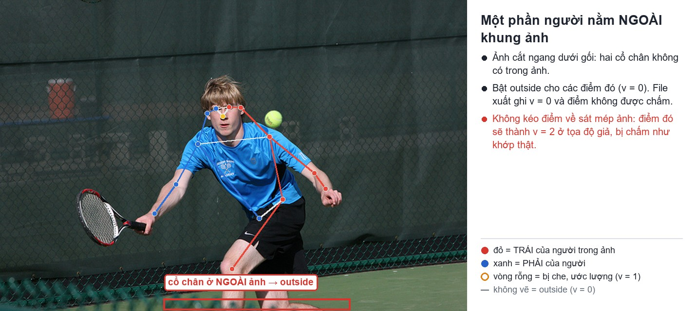

### A6. Không phải người thật thì không gán

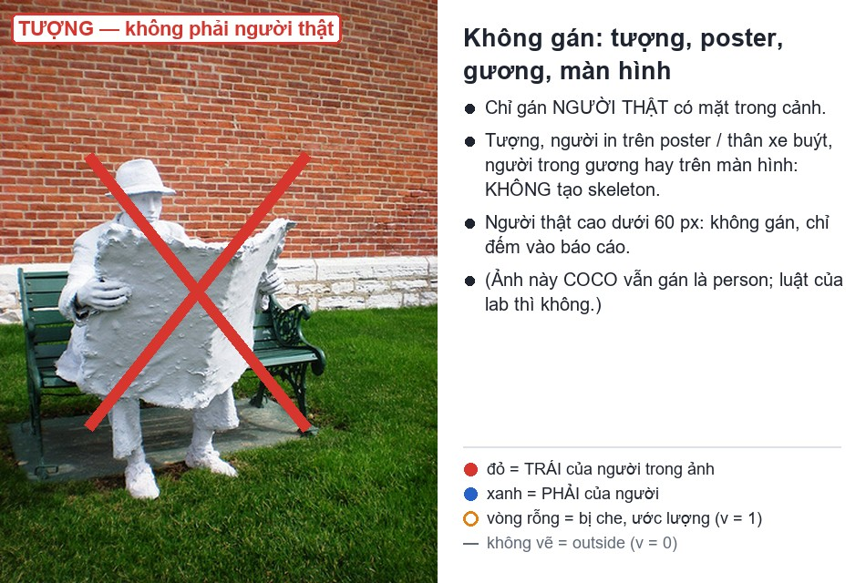

### A7. Khuôn mặt 13 điểm

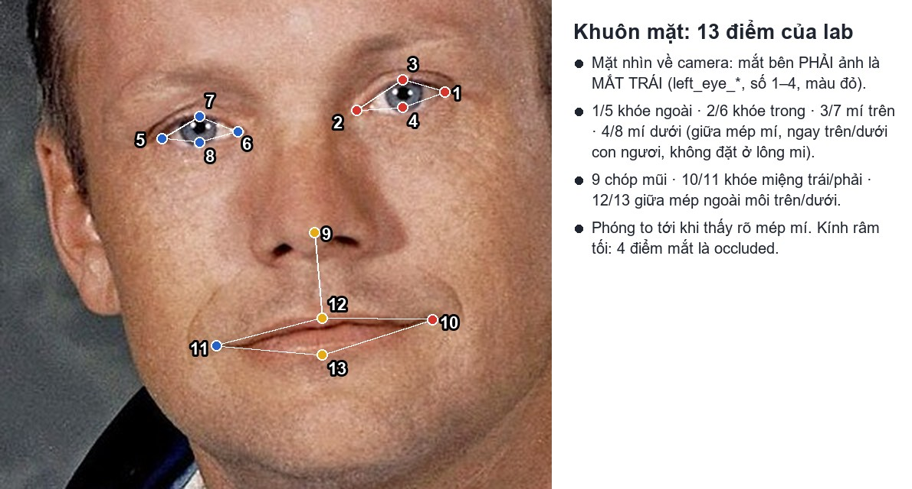

---

## Phần B — Làm trên CVAT, từng bước

### B0. Dựng bài bằng một lệnh

Mở Terminal (Windows: PowerShell) trong thư mục repo:

```bash
python lab.py check
python lab.py setup --mssv 20241234 --ten NguyenVanAn
```

(macOS / Ubuntu: `python3`.) Lệnh hỏi tài khoản CVAT Ngày 2 của bạn, tạo sẵn hai task với bộ ảnh riêng của bạn và in ra hai đường link. Bấm vào link là vào thẳng job. Máy chậm: xem [`MAY_YEU.md`](MAY_YEU.md).

### B1. Mở đúng job (nếu không dùng link)

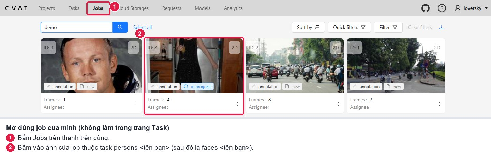

### B2. Làm quen màn hình gán nhãn

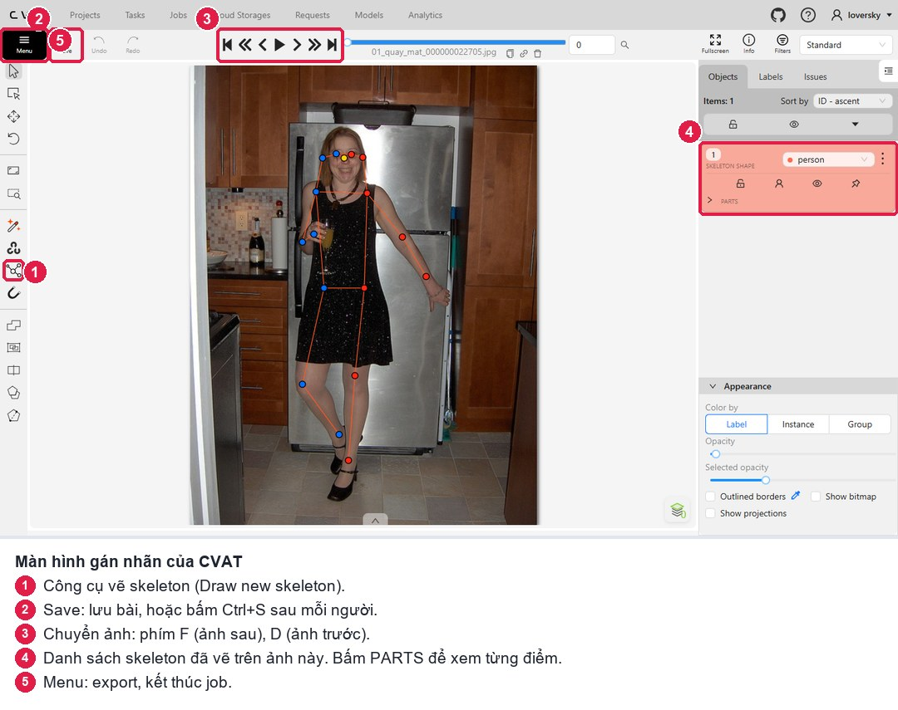

### B3. Vẽ một skeleton

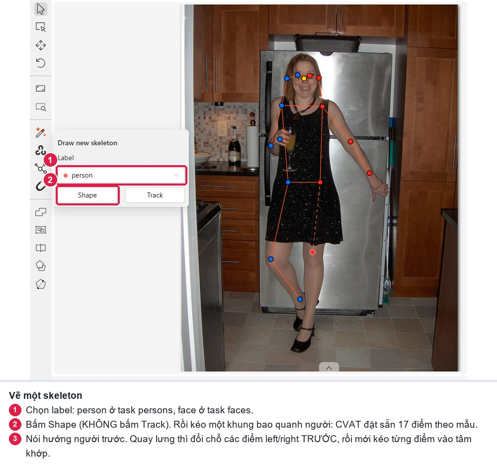

Sau khi kéo khung, CVAT đặt 17 điểm theo mẫu **người quay mặt**. Lần lượt kéo từng điểm vào **tâm khớp**: đầu → vai → tay → hông → chân. Phóng to (lăn chuột) khi đặt mắt, mũi, tai.

### B4. Đổi cờ cho một điểm

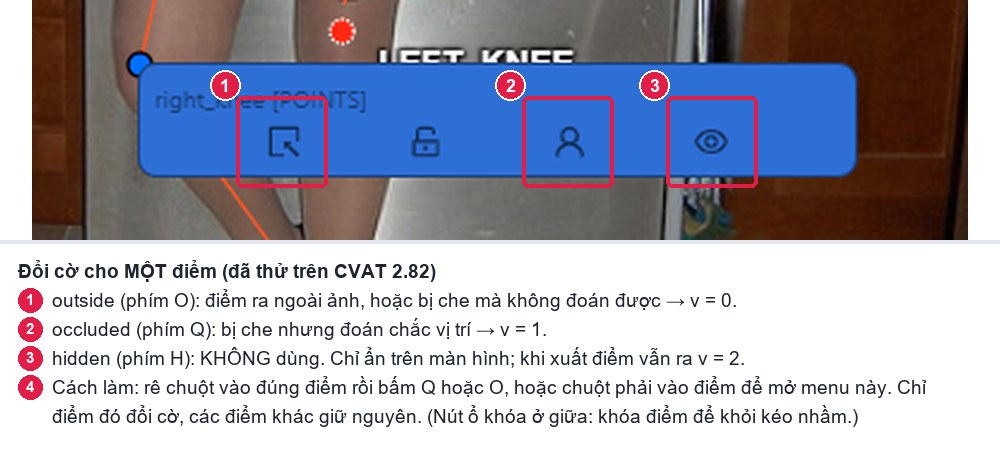

### B5. Kiểm lại trên ảnh

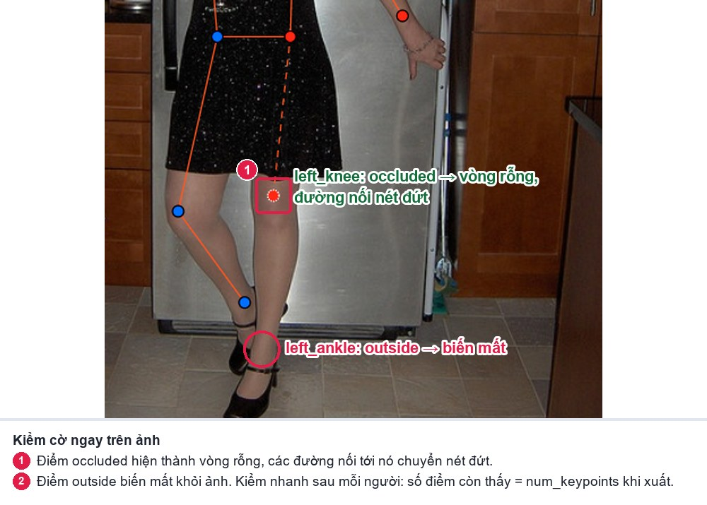

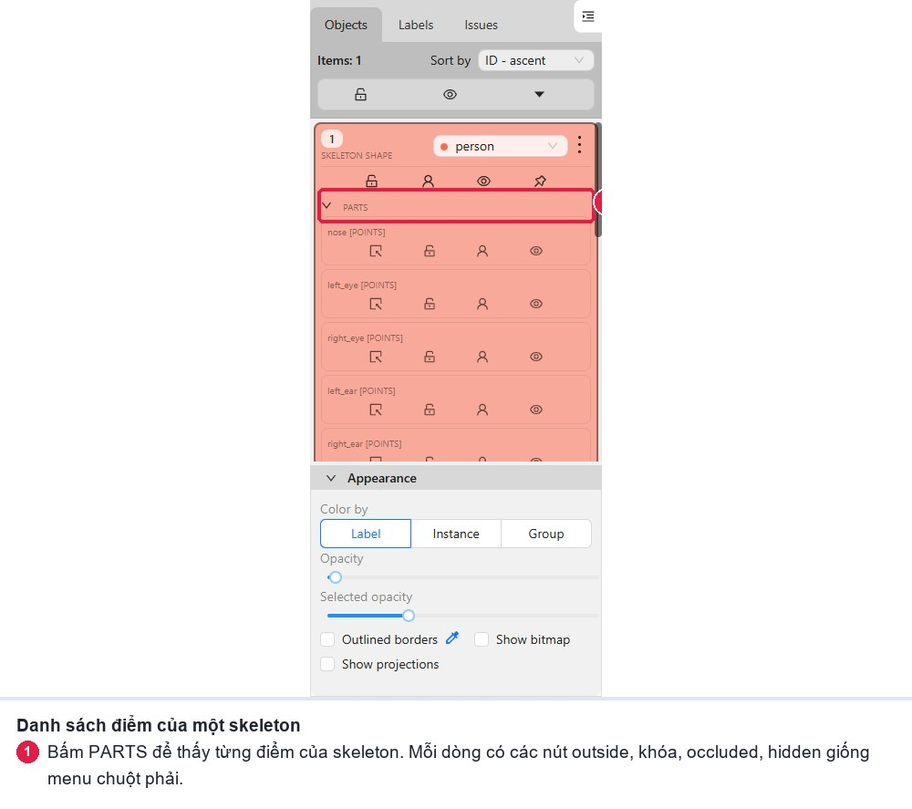

Bấm **Ctrl+S** sau mỗi người.

### B6. Task khuôn mặt

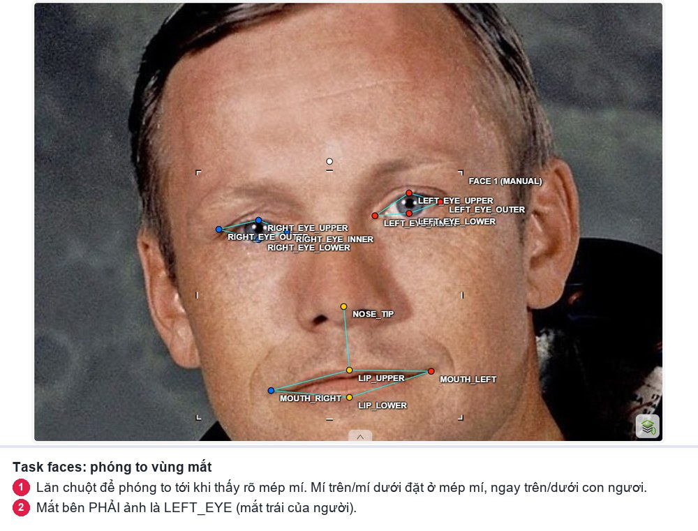

### B7. Xuất file

Cách nhanh, một lệnh xuất cả hai file và tự kiểm:

```bash
python lab.py export
```

Cách tay (khi cần): trang Task → Actions → Export task dataset.

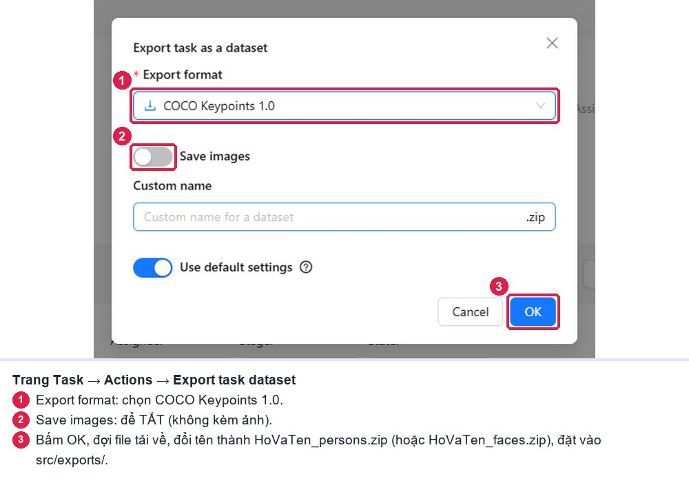

### B8. Kết thúc job

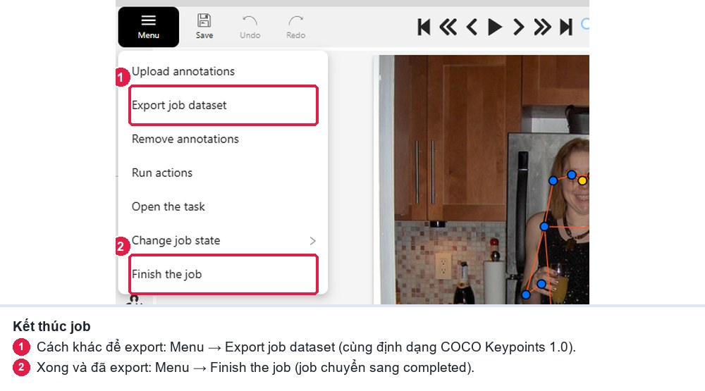

---

## Phần C — Tự kiểm trước khi nộp

- [ ] Mỗi người cao từ 60 px có đúng một skeleton; không gán tượng, poster, gương, màn hình.
- [ ] Đã nói hướng người trước khi kéo điểm; điểm đỏ (trái) nằm đúng bên.
- [ ] Không có điểm nào bị kéo về sát mép ảnh: điểm ngoài ảnh đã bật `outside`.
- [ ] Không dùng `hidden` (phím H).
- [ ] Mặt nhìn về camera: `left_eye_*` nằm bên phải ảnh.
- [ ] Script tự kiểm in `Kết quả: ĐẠT`.

Nguồn ảnh minh họa: [`images/NGUON_ANH.md`](images/NGUON_ANH.md).
